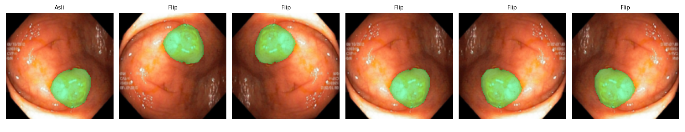
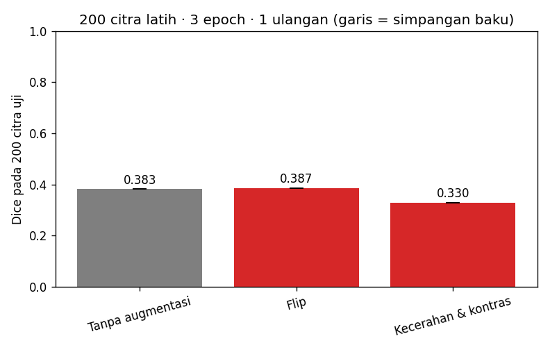
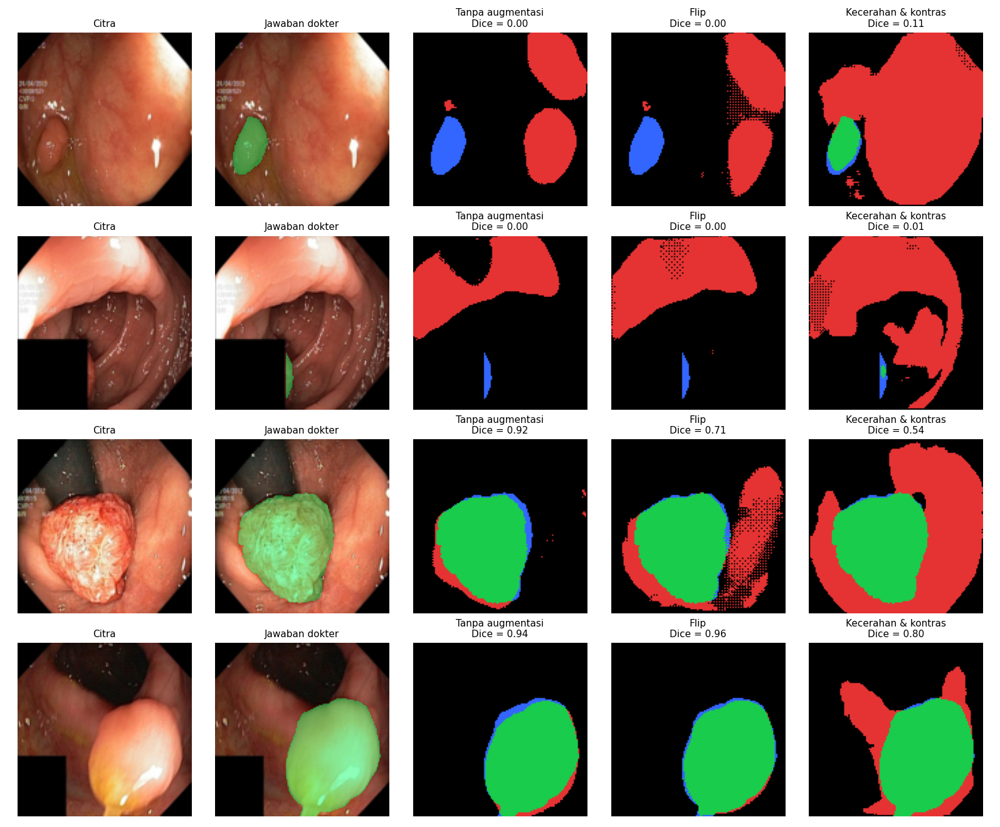

# Segmentasi Polip pada Citra Kolonoskopi dengan U-Net

<!--
  TEMPLATE LAPORAN — Tugas P10 Kecerdasan Buatan (BM25-41204), Teknik Biomedis ITERA.
  Petunjuk lengkap: https://mctm.web.id/ai-bm/tugas

  Cara memakai:
  - Ganti semua teks yang diawali "✍️" dengan tulisan kelompokmu, lalu hapus tanda ✍️-nya.
  - Blok komentar seperti ini adalah petunjuk; tidak tampil di GitHub. Boleh dihapus.
  - Gambar diambil dari folder hasil/ yang dibuat otomatis oleh notebook.
  - Jangan hapus judul-judul bagian (##).
-->

**Tugas P10 — Kecerdasan Buatan (BM25-41204), Teknik Biomedis ITERA**

## Anggota kelompok

| Nama | NIM | Username GitHub | Kontribusi utama |
|---|---|---|---|
| Reyhand Shevanco | 123430114 | Reyhand-del | Menjalankan eksperimen, membuat repository |
| M.Fadhil Ananta Putra | 123430085 | Fadhil085 | Menuliskan Bagian 3, 4, 5 |
| M. Falih Akbar | 123430111 | Kelibear | Membantu Analisis dan Evaluasi untuk bagian 4, 5, dan 6, dengan bantuan AI |

## 1. Pertanyaan

Augmentasi apa yang membantu U-Net menemukan polip pada citra kolonoskopi, dan augmentasi apa yang tidak? Kenapa?

## 2. Data & pengaturan

<!-- Isi dari Bagian 2 notebook. Pastikan CEPAT = False untuk hasil akhir. -->

- Dataset: Kvasir-SEG (1000 citra kolonoskopi + mask polip), diperkecil ke 128 × 128 piksel.
- Data uji: 200 citra (tetap). Data latih: 200 citra per ulangan.
- Model: U-Net mini (±0,5 juta parameter), 40 epoch, 3 ulangan per skenario.
- Dijalankan di: Google Colab T4 


## 3. Skenario augmentasi & hipotesis

<!-- Tulis bagian ini SEBELUM menjalankan eksperimen. Commit dulu, baru jalankan.
     Alasan klinis = kenapa variasi ini mungkin (atau tidak mungkin) terjadi pada kolonoskopi sungguhan. -->

| Skenario | Augmentasi (kode) | Alasan klinis | Hipotesis: Dice naik/turun/sama? |
|---|---|---|---|
| Tanpa augmentasi | — | Pembanding | — |
| Geometri | "Geometri (Flip)": v2.Compose([v2.RandomHorizontalFlip(p=0.5),v2.RandomVerticalFlip(p=0.5),]) | Kamera endoskop berputar di dalam usus sehingga posisi polip bisa tampak terbalik tanpa mengubah bentuk aslinya | Dice naik |
| Color Jitter | "Warna Ekstrem (ColorJitter)": v2.ColorJitter( brightness=0.4, contrast=0.4 saturation=0.4, hue=0.2) | Polip dibedakan dari dinding usus berdasarkan warna kemerahannya; perubahan warna ekstrem mengaburkan ciri jaringan ini | Dice turun |

Contoh augmentasi yang dicoba:


<!-- Ganti nama file sesuai skenario kalian (lihat isi folder hasil/). -->

## 4. Hasil

<!-- Tempel isi hasil/ringkasan.md di sini. -->

| Skenario | Dice (rata-rata ± sb) | IoU (rata-rata ± sb) | Dice tiap ulangan |
|---|---|---|---|
| Tanpa augmentasi | 0.584 ± 0.025 | 0.467 ± 0.027 | 0.575, 0.618, 0.559 |
| Geometri | 0.631 ± 0.046 | 0.524 ± 0.045 | 0.568, 0.675, 0.650 |
| Color Jitter | 0.484 ± 0.073 | 0.374 ± 0.053 | 0.558, 0.510, 0.385 |

 

## 5. Analisis peta kesalahan



<!-- Hijau = benar, merah = false positive, biru = false negative.
     Pertanyaan pemandu: Polip seperti apa yang sering terlewat (kecil? datar? warna mirip dinding usus?)
     Apa yang sering dikira polip padahal bukan? Apakah augmentasi memperbaiki kasus sulit? -->

Visualisasi peta kesalahan (*error map*) memperlihatkan bahwa model U-Net berhasil mendeteksi polip bertangkai atau menonjol dengan batas tegas secara optimal, ditandai oleh dominasi area hijau (*true positive*). Sebaliknya, area biru (*false negative*) cenderung terkonsentrasi pada lesi datar (*flat/sessile*) serta polip berukuran mikro yang gradasi warnanya menyatu dengan mukosa dinding usus, sehingga luput dari segmentasi. Sementara itu, area merah (*false positive*) kerap terdistribusi di sekitar lipatan dinding kolon (*haustral folds*) dan area pantulan kilau cahaya endoskop (*specular reflection*) yang menyerupai kontur jaringan polip. Meskipun manipulasi kontras dan saturasi (*Color Jitter*) pada beberapa sampel spesifik mampu mengonversi area biru menjadi hijau (menangkap lesi yang samar), teknik ini rentan memperluas persebaran area merah akibat meningkatnya sensitivitas model terhadap variasi warna dan tekstur mukosa sehat.

## 6. Pembahasan & kesimpulan

<!-- Bandingkan hasil dengan hipotesis di Bagian 3. Hipotesis yang ternyata salah tetap bernilai,
     asalkan dijelaskan kenapa. Perbedaan kecil (lebih kecil dari simpangan baku) belum tentu berarti. -->

Evaluasi komparatif antara capaian kuantitatif dan inspeksi kualitatif pada 200 citra uji secara konsisten memvalidasi hipotesis awal:

1. **Augmentasi Geometri (*Flip*) terbukti menguntungkan:** Rata-rata skor Dice meningkat signifikan dari 0.584 ± 0.025 (tanpa augmentasi) menjadi 0.631 ± 0.046, dengan peningkatan skor IoU dari 0.467 menjadi 0.524. Kenaikan yang melampaui rentang simpangan baku ini mengonfirmasi relevansi klinisnya: pergerakan dan rotasi kamera endoskop di dalam rongga usus menuntut model memiliki invariansi spasial terhadap orientasi tanpa merusak integritas morfologi lesi.
2. **Augmentasi Warna Ekstrem (*Color Jitter*) merugikan segmentasi:** Performa model terdegradasi tajam dengan penurunan rata-rata skor Dice ke angka 0.484 ± 0.073 serta deviasi yang tinggi antar-ulangan (0.385–0.558). Temuan ini membuktikan bahwa perubahan drastis pada kecerahan, saturasi, dan corak (*hue*) justru mengaburkan fitur pembeda utama polip, yakni vaskularisasi dan eritema (rona kemerahan alami terhadap mukosa normal). Akibatnya, model mengalami peningkatan *false positive* secara global pada lipatan dinding usus.

Kenaikan skor pada sampel spesifik di peta kesalahan (misalnya dari 0.09 ke 0.47) hanyalah fenomena lokal pada kasus berbatas lesi ambigu, bukan representasi performa generalisasi model secara keseluruhan. Dengan demikian, augmentasi geometri sangat direkomendasikan untuk segmentasi polip kolonoskopi, sedangkan perturbasi warna intensitas tinggi sebaiknya dihindari atau dibatasi pada rentang yang konservatif.

## 7. Pembagian kerja

<!-- Siapa mengerjakan apa. Penilaian proses kerja dilihat dari riwayat commit tiap anggota. -->

Reyhand Shevanco > Menjalankan eksperimen, membuat repository.
M.Fadhil Ananta Putra > Menuliskan Bagian 3, 4, 5.
M. Falih Akbar > Membantu Analisis dan Evaluasi untuk bagian 4, 5, dan 6, dengan bantuan AI.

## 8. Penggunaan AI

<!-- Wajib diisi, walau tidak memakai AI (tulis "Tidak memakai AI").
     Contoh: "Claude Code (CLI) untuk menulis skenario augmentasi dan memperbaiki error di Bagian 4.
     Draf Bagian 6 ditulis sendiri, lalu dirapikan bahasanya dengan bantuan AI." -->

Antigravity (CLI) untuk membantu menganalisis di bagian 4. 
Dan membantu memparafrase draf bagian 5 dan 6.

## Cara menjalankan ulang

```bash
uv sync
uv run jupyter lab segmentasi_polip.ipynb
```

Atau buka notebook di Google Colab (Runtime → Change runtime type → T4 GPU).

## Referensi

- Jha, D., dkk. (2020). Kvasir-SEG: A Segmented Polyp Dataset. *MultiMedia Modeling (MMM 2020)*, 451–462.
- Ronneberger, O., Fischer, P., & Brox, T. (2015). U-Net: Convolutional Networks for Biomedical Image Segmentation. *MICCAI*. arXiv:1505.04597.
- ✍️ tambahkan referensi lain yang kalian pakai
